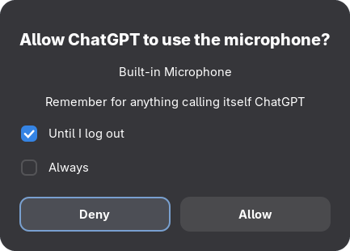
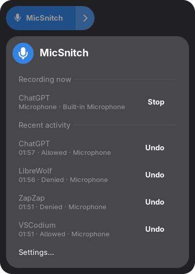
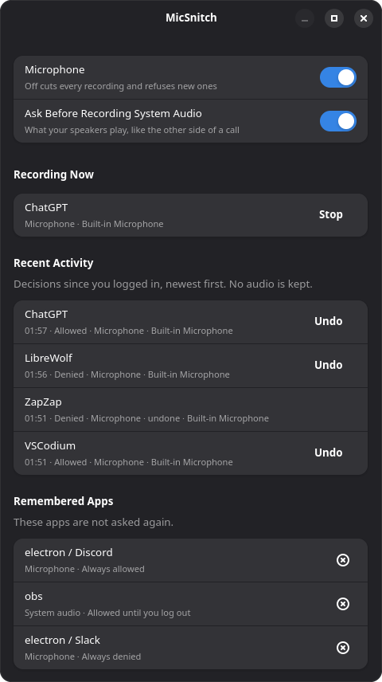

# MicSnitch

[](https://github.com/miralemalic/micsnitch/actions/workflows/tests.yml)

**Nothing listens until you say so.**

Any program you run can open your microphone without a word. Most never will.
MicSnitch is for the ones that might.

Every attempt to record, whether your microphone or whatever your speakers are
playing, is stopped at the door and brought to you. You decide. 

<p align="center">
  
</p>

## Works on

GNOME **48 to 51**, KDE **Plasma 6**, **Sway**, **Hyprland**, **niri** or
**COSMIC** on Wayland, PipeWire **1.2+** and WirePlumber **0.5.8+**.

| Tested on    | GNOME | Plasma | WirePlumber | PipeWire |
|--------------|-------|--------|-------------|----------|
| Fedora 45    | 51.0  | 6.7.5  | 0.5.18      | 1.6.9    |
| Fedora 44    | 50.5  | 6.7.5  | 0.5.17      | 1.6.9    |
| Fedora 43    | 49.10 | 6.7.5  | 0.5.14      | 1.4.11   |
| Ubuntu 26.04 | 50.1  | 6.6.6  | 0.5.13      | 1.6.2    |
| Debian 13    | 48.7  | 6.3.6  | 0.5.8       | 1.4.2    |
| Arch         | 50.5  | 6.7.5  | 0.5.18      | 1.6.9    |

Each one runs the tests in a container with a fake microphone, and a GNOME
Shell or a KWin no one can see. MicSnitch also runs on real hardware every
day, on Fedora 45 with GNOME. The KDE side is new and has only lived in those
containers so far. If you run it on a real Plasma, tell me how it went.

Sway, niri and COSMIC are newer still. Sway 1.10 to 1.12 passes the same tests
on Debian 13, Fedora 44 and Arch, and so do niri 26.04 and COSMIC 1.11 on
Fedora 44, each in a window on that Sway. Hyprland won't start without a
graphics card, so it has never run them. It gets the same tray app and nothing
says it shouldn't work, but nothing has shown that it does.

Other distros with these versions should hold up too, think openSUSE
Tumbleweed, Manjaro or EndeavourOS, but nobody has checked yet.

Out of reach: Ubuntu 24.04, Debian 12 and Linux Mint 22 ship WirePlumber 0.4,
which works differently. Other desktops have no handler yet. And on
WirePlumber older than 0.5.12, Debian 13 included, a request that times out is
refused without a notification.

## The setup

Two parts, one job.

- **The gate** lives inside WirePlumber, where every audio connection on the
  system is made. A request to listen is held there before a single sample
  moves.
- **The handler** puts the question in front of you, carries your answer back
  and keeps the log. On GNOME it's a Shell extension. Everywhere else it's a
  small app that lives in the system tray.

They speak through a PipeWire metadata object called `micsnitch`. To watch the
wire: `pw-metadata -m -n micsnitch`.

## Rules of engagement

- **Allow** opens the line for that one recording. The next one asks again.
- **Deny** cuts it and hands the app an error.
- **Remember** turns an answer into standing orders, until you log out or for
  good, for the microphone and system audio separately. Revoke them in the
  settings.
- An app turned away by standing orders gets no popup. A notification tells
  you instead, with an **Undo**.
- An app that knocks again within 30 seconds of your answer gets the same
  answer. Chromium-based apps knock three times for every click; you hear it
  once. **Stop** ends those 30 seconds early.
- The **MicSnitch** tile in Quick Settings shows who is listening right now,
  with a **Stop** for each. Switch the tile off and every line goes dead at
  once, and whoever tries meanwhile lands in the log. If the gate ever goes
  down, the tile shows a warning. Outside GNOME the tray icon does the same
  work, and its window holds the switch, the Stops and the log.
- A recording you never approved, because something answered in your place,
  sets off a notification with a **Stop**.
- **Recent activity** holds the latest decisions: ten in the GNOME menu, fifty
  in the settings and the tray app's window, none from before this login and
  never any audio. An allow or deny there can be taken back with **Undo**.
- On a locked screen, requests wait for you. Nothing is approved behind your
  back. With no handler at all, the answer after 15 seconds is no.

<table>
  <tr>
    <td align="center">
      
      <br>GNOME, from Quick Settings
    </td>
    <td align="center">
      
      <br>Everywhere else, from the tray
    </td>
  </tr>
</table>

## Field limits

MicSnitch is a checkpoint, not a vault. Know where its walls end.

- Most apps reach the sound system through PulseAudio, and there they name
  themselves. Anything can claim to be Discord, which is why the popup says
  "anything calling itself". Apps that talk to PipeWire directly are named by
  the kernel, down to the program on disk. For a script, that's its
  interpreter, python3 and all, so a script is only remembered together with
  the launcher that started it. One run from a terminal is asked every time.
- Code running as you and built to beat MicSnitch can forge an answer, rewrite
  the configuration or open the sound card directly through ALSA. A forged
  answer sets off a notification, which is one more thing such code could
  go after. Shutting that
  last door takes a rule in the kernel itself, one that lets only PipeWire near
  the hardware. MicSnitch doesn't go that deep yet. I plan to build it when I get
  the time, and a pull request that beats me to it would be welcome.
- A link raced in the instant an app connects is cut on sight, but a few
  milliseconds may already have slipped through.
- Apps lose PipeWire's link-factory, so patchbays like qpwgraph and Helvum,
  and JACK apps that wire their own ports, can't. Loading PulseAudio modules is
  switched off too: a loopback would be a tunnel under the gate.
- On an X11 session any app can fake input, a click on Allow included. GNOME 48
  still offers one, so pick Wayland at the login screen. The tray app won't
  run on X11 at all.
- Sway, Hyprland and niri leave locking to a program of its own. The screen
  counts as locked while swaylock, hyprlock, gtklock or waylock runs. COSMIC's
  lock screen can't be told from outside, so standing orders still apply
  behind it.

## Going further

MicSnitch watches the door. These keep people from climbing in through the
windows.

- **Sandbox what you don't trust.** Install it as a Flatpak and take its sound
  away in Flatseal: untick *PulseAudio socket*, and *All devices* too, or it can
  still reach the sound card directly. It can't hear anything then, but it can't
  play anything either.
- **Stop programs reaching into each other.** This keeps one program from
  hooking into another that's already running, MicSnitch included:

  ```sh
  sudo sysctl kernel.yama.ptrace_scope=1
  ```

  Ubuntu does this by default, Fedora doesn't. It lasts until the next reboot;
  to keep it, put `kernel.yama.ptrace_scope = 1` in a file under
  `/etc/sysctl.d/`. Debuggers then need `sudo` to attach.

## Install

```sh
git clone https://github.com/miralemalic/micsnitch
cd micsnitch
tools/install.sh
```

Everything goes into your own account, no root needed. Audio drops for a
second, so not mid-call. On GNOME, log out and back in to bring the handler
online; until you do, nothing can record. Elsewhere it's in the tray right
away. To update, `git pull` and run `tools/install.sh` again.

Sway and Hyprland started by hand have nothing that starts apps at login. The
installer notices, and gives you the line to put in your compositor's config.
On those and on niri the tray icon needs a bar with a tray, like Waybar, and
the notifications a daemon like mako.

Outside GNOME the handler needs a few packages first:

- Fedora: `sudo dnf install gjs libadwaita gtk4-layer-shell`
- Debian, Ubuntu: `sudo apt install gjs gir1.2-adw-1 gir1.2-gtk4layershell-1.0 libgtk4-layer-shell0 libglib2.0-bin`
- Arch: `sudo pacman -S gjs libadwaita gtk4-layer-shell`

On any other desktop the installer refuses: no handler means nothing could
ever be allowed. `--no-extension` installs the gate alone if
that's what you want, and `--no-restart` leaves the audio running until you
restart it yourself.

MicSnitch isn't on extensions.gnome.org. The site can only ship the handler,
and the handler is nothing without the gate.

To remove every trace of the gate, the handler and the log:

```sh
tools/uninstall.sh
```

Remembered answers stay behind, in GSettings on GNOME and in
`~/.config/micsnitch` everywhere else.

## Tests

Every test runs in a container with its own PipeWire, a fake microphone
playing a tone and, for the popup, a GNOME Shell, a KWin or a Sway no one can
see. Your desktop and your devices are never touched. Podman required.

```sh
tests/matrix.sh                          # the gate, on every distro
tests/container.sh fedora44 tests/run.sh # the gate, on one
tests/popup.sh fedora44                  # the handler, on GNOME 50
tests/popup.sh fedora44-kde              # the handler, on KDE Plasma
tests/popup.sh fedora44-sway             # the handler, on Sway
tests/harness.sh                         # the tests, tested
```

`debian13` has GNOME 48, `fedora43` 49, `fedora44` 50 and `fedora45` 51. Add
`-kde` to any of them, or to `ubuntu2604` and `arch`, for Plasma, and `-sway`
for Sway. `fedora44` also takes `-niri` and `-cosmic`.

## License

MIT. See [LICENSE](LICENSE).
